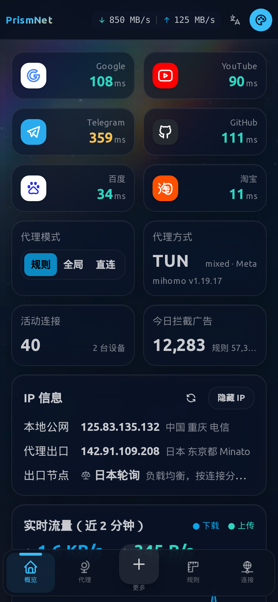

# PrismNet

**PrismNet** 是 [metacubexd](https://github.com/metacubex/metacubexd) 的魔改版：只面向 **mihomo** 核心，
把旁路由日常要看的东西都放进一个面板，并配一个小巧的 Go 后端（单个静态二进制，支持 linux arm64 / amd64），
提供站点延迟、IP 信息、广告拦截、DNS 统计、看门狗与**在线更新**。

| 桌面                                               | 手机                                         |
| -------------------------------------------------- | -------------------------------------------- |
|  |  |

## 功能

保留 metacubexd 的全部功能（代理 / 规则 / 连接 / 流量统计 / 日志 / 配置 / 多语言 / 主题 / 背景图 / PWA），默认中文，并新增：

- **概览**
  - 站点延迟：Google、YouTube、Telegram、GitHub、百度、淘宝，带图标、毫秒数与近 30 次柱状历史；
    测法为「先建连，复用连接计时第二次请求」，与 mihomo `unified-delay` 口径一致。
  - 代理模式（规则 / 全局 / 直连）一键切换；代理方式（TUN / TProxy / Mixed，核心版本）。
  - 活动连接数 + 设备数；今日拦截广告数 + 规则条数。
  - IP 信息：本地公网 IP（归属地 / 运营商）、代理出口 IP 与归属地、出口节点，「隐藏 IP」一键打码。
  - 实时流量（近 2 分钟）曲线。
  - 域名过滤：24 小时平均解析耗时、连接请求、已拦截占比（迷你曲线）、被拦截域名排行 Top 5、管理入口与总开关。
  - 节点选择：主选择组下的全部策略组（地区竞技 url-test、哈希 consistent-hashing、轮询 round-robin、手动选择、全局自动选择、直连），显示当前节点与延迟，点按切换，一键测速。
  - 当前负载均衡：策略组 → 成员节点拓扑（每个节点的连接数与速率），「拓扑」页查看全部负载均衡组。
  - 故障自动直连（看门狗）：每 30 秒检查核心，无响应自动重启；连续 2 次失败关闭透明代理让局域网直连，核心恢复后自动接管；保留最近 20 条事件。
  - DNS 查询结果：最近 100 条查询中缓存命中 / 上游应答 / 其它的占比环形图。
- **拓扑**：所有负载均衡组的成员、健康、连接与速率。
- **统计**：原 metacubexd 概览（流量 / 内存 / 连接图表与排行）。
- **PrismNet 设置**：后端与核心状态、重启核心、在线更新、广告拦截列表与黑白名单、看门狗开关与完整事件。
- 深色玻璃卡片风格 + 默认背景图（可在「配置 → 外观」更换）。

## 安装

在运行 mihomo 的设备（如 Alpine 旁路由）上以 root 执行：

```sh
curl -fsSL https://raw.githubusercontent.com/Skycnhe/prismnet/main/install.sh | sh
# 国内网络可加速下载：
curl -fsSL https://gh-proxy.com/https://raw.githubusercontent.com/Skycnhe/prismnet/main/install.sh | PRISMNET_MIRROR=https://gh-proxy.com/ sh
```

脚本会：下载最新发布包并校验 SHA-256 → 安装到 `/opt/prismnet` → 首次安装时从 `/etc/mihomo/config.yaml`
读取 `external-controller` / `secret` / `mixed-port` 生成 `/etc/prismnet/config.json` → 注册并启动服务
（Alpine 用 OpenRC，其它发行版用 systemd）。完成后打开 `http://<设备IP>:7880/`。

离线安装：从 [Releases](https://github.com/Skycnhe/prismnet/releases) 下载 `prismnet-linux-<arch>.tar.gz`，解压后运行 `sh install.sh ./prismnet-linux-<arch>.tar.gz`。

卸载：`sh /opt/prismnet/uninstall.sh`（加 `--purge` 同时删除配置与数据）。

## 配置

`/etc/prismnet/config.json`（修改后重启服务：`rc-service prismnet restart` 或 `systemctl restart prismnet`）：

```jsonc
{
  "listen": ":7880", // 面板监听地址
  "secret": "", // 面板访问密钥（留空不校验；设置后在连接页填写）
  "data_dir": "/var/lib/prismnet",
  "ui_dir": "/opt/prismnet/ui",
  "mihomo": {
    "controller": "http://127.0.0.1:9090", // mihomo external-controller
    "secret": "", // mihomo secret（由后端代为附加，浏览器无需知道）
    "mixed_port": 7890, // 站点延迟 / 代理出口 IP 经此端口测量
    "config_path": "/etc/mihomo/config.yaml", // 广告拦截开关会修改它（自动备份为 .prismnet.bak）
    "service": "mihomo", // 看门狗重启用的服务名
  },
  "watchdog": {
    "enabled": true,
    "interval": 30,
    "timeout": 8,
    "fail_threshold": 2,
    "restart_cmd": "", // 默认 rc-service <service> restart / systemctl restart <service>
    "bypass_cmd": "", // 切换直连；默认停止核心（TUN / 透明代理路由随之撤销）
    "restore_cmd": "", // 核心恢复后执行（如重新加载 nftables 透明代理规则）
  },
  "sites": [
    {
      "name": "Google",
      "url": "https://www.google.com/generate_204",
      "icon": "google",
    },
  ],
  "update": { "repo": "Skycnhe/prismnet", "proxy": false, "mirror": "" },
}
```

## 架构

```
浏览器 ──► PrismNet 后端 (:7880)
            ├─ /                 面板静态文件（packages/ui 构建产物）
            ├─ /config.js        让面板默认连接同源的 /mihomo
            ├─ /mihomo/*         反向代理 mihomo 外部控制器（含 WebSocket），附加核心密钥
            └─ /mihomo/prism/*   扩展 API：sites、ipinfo、stats、adblock、watchdog、update、core/restart
```

- 广告拦截：下载过滤列表（hosts / AdGuard `||domain^` / 纯域名 / Clash 规则集）→ 合成
  `<核心配置目录>/prismnet/prism-adblock.txt`（text / domain 规则集）；开启时在核心配置 `rules` 最前面加入
  `AND,((RULE-SET,prism-adblock),(NOT,((RULE-SET,prism-adallow)))),REJECT` 并热重载，关闭时移除。列表每天自动更新。
- 统计：后端订阅 mihomo `/logs?level=debug` 日志流，按小时统计连接请求与拦截，记录最近 100 条 DNS 查询来源；
  每分钟经 `/dns/query` 解析随机子域名得到平均解析耗时。
- 在线更新：读取 GitHub 最新 Release，下载 `prismnet-linux-<arch>.tar.gz`，按 `sha256sums.txt` 校验后替换
  面板目录与后端程序（旧版本保留为 `.bak`），然后原地重启。

## 开发

```sh
pnpm install
pnpm --filter @metacubexd/ui dev:mock      # 演示数据预览面板
cd server && go test ./...                  # 后端测试（Go 1.24+）
VERSION=v0.1.0 sh scripts/build-release.sh  # 构建发布包到 dist/
```

发布：推送 `v*` 标签，GitHub Actions 会构建面板与两个架构的后端并发布 Release。

## 致谢与许可

PrismNet 基于 [MetaCubeX/metacubexd](https://github.com/metacubex/metacubexd)（MIT）修改，原项目说明见
[docs/README.metacubexd.md](docs/README.metacubexd.md)。部分思路（站点延迟测法、看门狗、广告拦截统计、地区策略组展示）
来自作者自己的 Shunt 面板。本项目以 [MIT](LICENSE) 许可发布，保留原作者版权声明。
